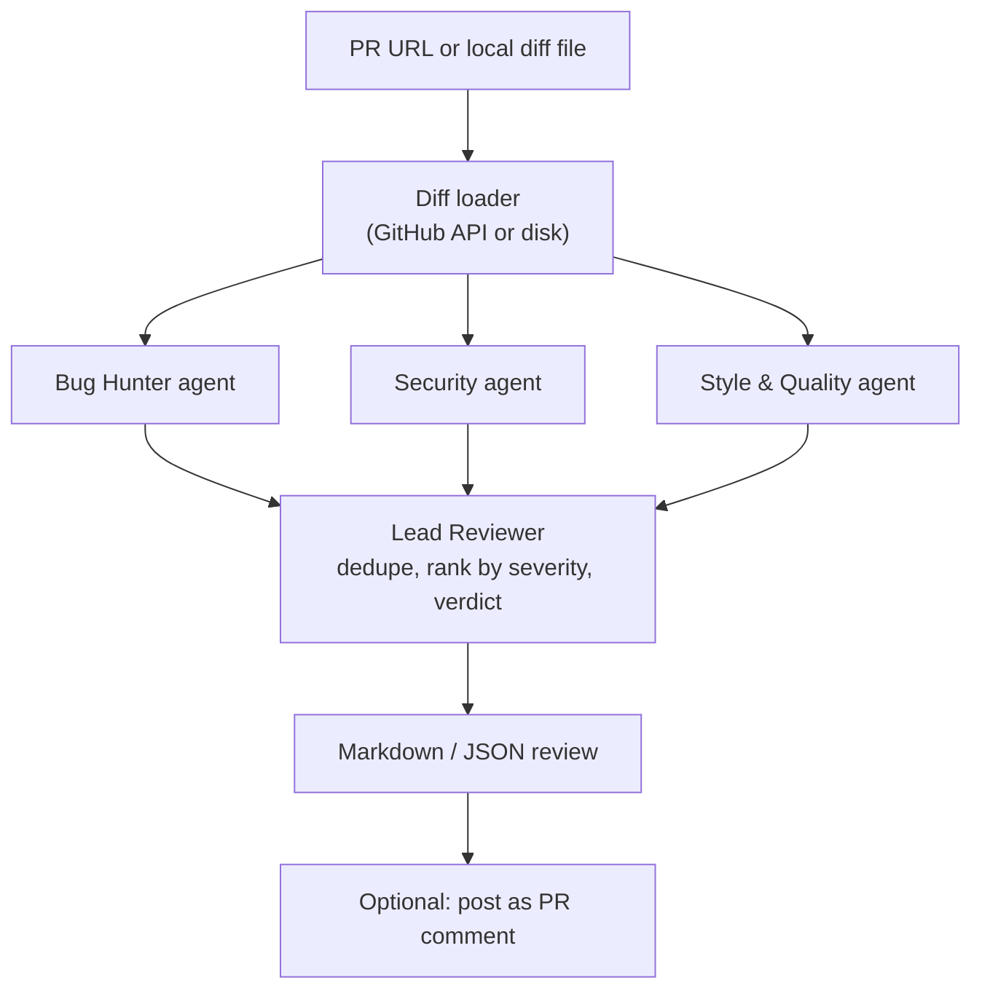

# AI Code Review Agent

A team of AI agents that reviews a pull request the way a real team
would: three specialists look at the same diff from different angles, and
a lead reviewer merges their notes into one ranked, readable review.

- **Bug Hunter** — logic errors, unchecked `None` returns, off-by-one
  mistakes, race conditions, swallowed errors.
- **Security** — SQL injection, hardcoded secrets, unsafe
  deserialization, missing auth checks.
- **Style & Quality** — readability, naming, duplication, missing
  docstrings and tests.
- **Lead Reviewer** — deduplicates the findings, ranks them by severity,
  and writes the final verdict: *approve* or *request changes*.

The pipeline is orchestrated with **LangGraph**, the agents talk to the
model through **LangChain**, and the whole thing is available both as a
CLI and as a small **FastAPI** service. It can also post its review back
to the pull request as a GitHub comment.

## Try it in 30 seconds (no API key needed)

Demo mode swaps the language model for a built-in, rule-based stand-in,
so the full pipeline runs offline with nothing to configure:

```bash
git clone https://github.com/Afrid1691/ai-code-review-agent.git
cd ai-code-review-agent
python -m venv .venv && source .venv/bin/activate
pip install -r requirements.txt

python -m review_agent --diff examples/sample_pr.diff --demo
```

The sample diff is a small Python change with a few real problems
planted in it — a string-formatted SQL query, a committed API key, a
missing `None` check, and a bare `except:` — so you can see exactly what
the reviewers catch. The expected output is in
[examples/expected_review.md](examples/expected_review.md).

Demo mode is also the automatic fallback whenever `OPENAI_API_KEY` is
not set, and the CLI says so when it happens.

## How it works



The three specialists run in parallel as LangGraph nodes, each with its
own prompt and its own JSON findings format. The lead reviewer node does
the merging in plain code — deduplication and severity ranking should be
deterministic, not a coin flip inside a model — and only the opening
summary paragraph is written by the model.

## Real reviews with an OpenAI key

```bash
cp .env.example .env   # then put your key in it
export OPENAI_API_KEY=sk-...

# Review a GitHub pull request
python -m review_agent --pr https://github.com/owner/repo/pull/42

# Review a local diff, save the Markdown, print JSON instead
python -m review_agent --diff changes.diff --output review.md
python -m review_agent --diff changes.diff --json
```

`OPENAI_MODEL` selects the model (defaults to `gpt-4o-mini`).

## Posting the review back to the PR

With a GitHub token that can write to the repo's pull requests:

```bash
export GITHUB_TOKEN=ghp_...
python -m review_agent --pr https://github.com/owner/repo/pull/42 --post-comment
```

The review is posted as a single PR comment in the same Markdown format
the CLI prints.

## API

```bash
uvicorn review_agent.api:app --reload
```

```bash
curl -X POST localhost:8000/review \
  -H 'Content-Type: application/json' \
  -d '{"diff": "<unified diff text>", "demo": true}'
```

`POST /review` returns the verdict, the ranked findings as JSON, and the
rendered Markdown. `GET /health` is a plain liveness check. A Dockerfile
is included: `docker build -t ai-code-review-agent .` then
`docker run -p 8000:8000 ai-code-review-agent`.

## Example output (demo mode, sample diff)

> **Verdict: Request changes**
>
> This change needs work before it merges: 2 critical, 2 high, 3 low
> finding(s) across the three reviewers. The most urgent item is
> "Hardcoded secret committed to source code" in app/config.py.
>
> ### 1. [CRITICAL] Hardcoded secret committed to source code
> *app/config.py:8 — reported by Security*
>
> The API_KEY is assigned a literal value in the source. Anyone with
> repo access (and anyone the repo leaks to) now has the credential, and
> it lives in git history even after it is removed.
>
> **Suggested fix:** Read the value from an environment variable or a
> secrets manager, and rotate the exposed credential.
>
> ### 2. [CRITICAL] SQL injection via string-formatted query
> *app/users.py:20 — reported by Security*
> ...

Full output: [examples/expected_review.md](examples/expected_review.md).

## Tests

```bash
python -m pytest
```

The suite runs the graph in demo mode against the sample diff and checks
that the planted SQL injection and hardcoded secret are caught, that
findings come back ranked by severity, and that the verdict is "request
changes". No network, no API key.

## Project structure

```
review_agent/
    graph.py          LangGraph state graph, lead-reviewer merge, Markdown rendering
    agents.py         Specialist reviewer runners and findings parsing
    prompts.py        Role prompts for the four reviewers
    demo_llm.py       Rule-based stand-in model used in demo mode
    github_client.py  Fetch PR diffs and post comments (plain requests)
    cli.py            python -m review_agent
    api.py            FastAPI app (POST /review, GET /health)
examples/
    sample_pr.diff        Small PR with planted issues
    expected_review.md    Demo-mode review of the sample diff
tests/
    test_review.py        End-to-end tests, all in demo mode
```

## About the author

Built by Afrid Mohammed — Software Developer (Python, Java, Spring Boot,
Kafka, AWS) working with LangGraph, LangChain, RAG and multi-agent
systems.
